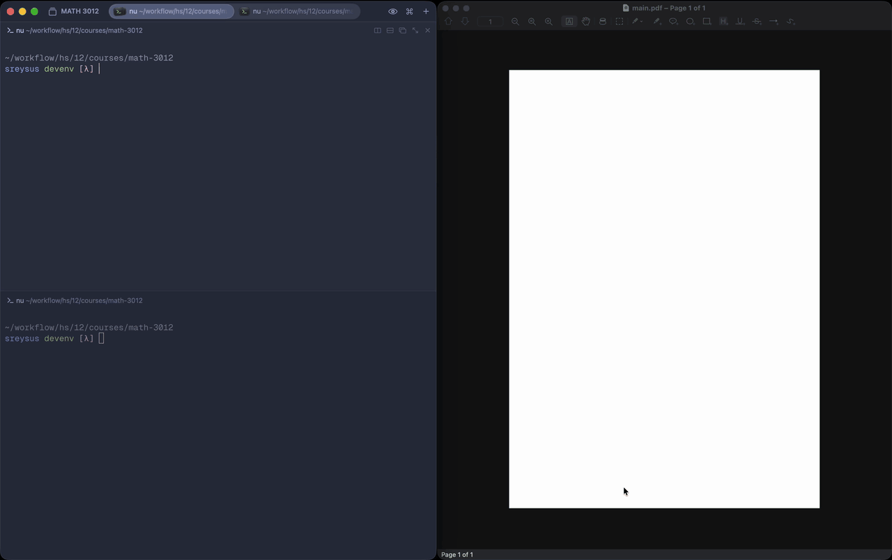

# petersen

Draw a graph with the mouse in your terminal, then paste it into
[Typst](https://typst.app) as a [Fletcher](https://typst.app/universe/package/fletcher)
figure that looks the same as on screen.



```sh
nix run github:sreyassabbani/petersen
```

Needs a terminal with Kitty graphics (Ghostty, Kitty, WezTerm, Rex). iTerm2 and
Sixel terminals use a slower fallback. Copy uses `pbcopy`, so it works on macOS only.

## Controls

| Do | How |
| --- | --- |
| Add a vertex | Click empty canvas |
| Connect two vertices | Click one, then the other (Esc cancels) |
| Select | Drag a box, or Ctrl/Cmd-click to toggle; `a` selects all |
| Move | Drag a vertex (the whole selection moves); arrow keys nudge |
| Change style | Double-click a vertex, or `s`: dot → circle → plain |
| Label | Enter, or the Label button; an empty label removes it |
| Renumber 1…n | `R` |
| Delete | Backspace |
| Pan / zoom | Scroll or right-drag / Ctrl-scroll, `+` `-`, `F` fits |
| Undo / redo | `u` / `U` (or ⌘Z / ⌘⇧Z) |
| Copy as Typst | Copy button or Ctrl-C |
| Quit | `q` (asks again if you haven't copied) |

Each launch starts with an empty canvas, and nothing is saved.

## In Typst

Copy [`typst/graph.typ`](typst/graph.typ) into your project, import it once,
and paste:

```typst
#import "graph.typ": graph

#graph(
  vertices: (
    v1: (-3, 3, [1]),
    v2: (2, 3, [2]),
    v3: (-3, 0, [3]),
  ),
  edges: (
    ("v1", "v2"),
    ("v1", "v3"),
  ),
)
```

Each vertex is `(x, y, label)`. Add `"circles"` or `"plain"` as a fourth
field to style one vertex, or pass `style: "circles"` for all of them.
Labels accept Typst content such as `[$v_1$]`. You can also pass `unit: 10mm`,
`labels: false` or `label-directions: (v1: "n")`.

## Development

`nix develop`, then `cargo test`. If `typst` is on `PATH`, the tests also
compile the exported code. [docs/internals.md](docs/internals.md) explains how
rendering works and lists what each module does.
